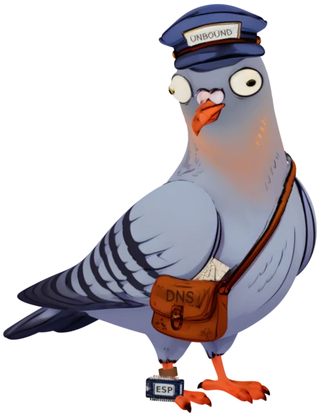

# espDNS



Meet Artie A. Record, the espDNS pigeon. He carries your answers.

A full-featured DNS server for small, low-power ESP32 boards. Run two or more nodes and
they flock together: one can be down or updating while clients keep resolving. A web
controller, run with Docker Compose, sets them up and keeps them updated.

> **Status: alpha (0.0.x).** It runs a real network today, but anything may change between
> versions. Read the [changelog](CHANGELOG.md) before you update.
>
> 0.0.3 is a breaking change: nodes on 0.0.1 or 0.0.2 must be installed again over USB.

## Features

On each node:

- Your own hosted zones, edited in the controller. They arrive signed and apply live.
- Secondary zones copied from any standards-compliant primary (BIND, Knot, PowerDNS,
  Windows DNS, Technitium and others) by zone transfer, kept fresh by SOA checks and
  NOTIFY. They're kept on the microSD card, so nodes answer while the primary is down.
- Forwarders for the names the node doesn't hold. Forward zones send chosen names to their
  own servers. Recursion is for private client addresses only.
- A cache in PSRAM, sized per board.
- Blocklists: Adblock, hosts, domains, wildcard and RPZ lists by URL or file, plus your own
  block and allow lists. The controller compiles them and refuses a list whose size changes
  too much, and every node gets the same one. You can pause blocking, or roll back to the
  previous list.
- Overrides, your own block and allow rules on top of the lists, applied live.
- A log of recent queries and traffic charts in the controller, plus Prometheus metrics at
  `/metrics` on every node.
- Health state at `/health` and on an LED. Failed services restart on their own.

Across the fleet:

- Two or more nodes answer together, with no leader and no shared state. A node never
  depends on the controller: turn it off and DNS goes on.
- Firmware, config, zones and lists go out as signed releases (ECDSA P-256), each bound to
  one node and refused if replayed. The controller rolls them out one node at a time and
  never takes down the last healthy one.
- A web controller to adopt nodes, edit settings, zones and lists, review and apply
  changes, flash new boards from the browser, and back up and restore. The `espdns` CLI
  ships in the same Docker image.

## Quick start

You need a Linux machine with Docker, Chrome or Edge, and two boards from the
[catalog](docs/hardware.md).

```sh
mkdir -p -m 700 espdns/data && cd espdns
curl -fsSLO https://github.com/skitzo2000/espDNS/releases/latest/download/compose.yaml
printf 'ESPDNS_UID=%s\nESPDNS_GID=%s\n' "$(id -u)" "$(id -g)" > .env
docker compose up -d
```

Open http://127.0.0.1:8480 and follow the setup. [Getting started](docs/getting-started.md)
walks through it.

## Supported boards

A board is a JSON file in the [board catalog](boards/README.md), not code. The firmware is
built once per chip; the board file says how the board is wired.

| Board | Chip | Network | Tier |
|---|---|---|---|
| Guition JC-ESP32P4-M3-DEV (`p4-ip101`) | ESP32-P4, 32 MB PSRAM | Ethernet (built-in MAC) | Tested |
| Waveshare ESP32-P4-ETH (`ws-p4-eth`) | ESP32-P4, 32 MB PSRAM | Ethernet (built-in MAC), optional PoE module | Tested |
| Waveshare ESP32-S3-ETH (`ws-s3-eth`) | ESP32-S3, 8 MB PSRAM | Ethernet (W5500), optional PoE | Tested |
| Seeed XIAO ESP32S3 Sense (`xiao-s3-sense`) | ESP32-S3, 8 MB PSRAM | Wi-Fi, or Ethernet with an added W5500 | Tested |

Wire your nodes if you can; Wi-Fi is a best-effort fallback. Every board needs 8 MB of
PSRAM or more. Describe your own board in the controller's builder.

## Documentation

| Document | What it covers |
|---|---|
| [Getting started](docs/getting-started.md) | Start the controller and run the setup |
| [Developer guide](docs/developer.md) | Docker Compose, the command line, setup in detail, how firmware is checked, your own build, tests and make targets |
| [Hardware](docs/hardware.md) | The tested boards, what a board needs, and describing your own board |
| [Zones and forwarding](docs/zones.md) | Hosted, secondary and forward zones, and the default forwarders |
| [Blocking](docs/blocking.md) | Blocklists, overrides, pausing, the query log and the charts |
| [Operations](docs/operations.md) | Updating the controller and the nodes, pinned nodes, nodes without keys, rotating keys, backup, restore and recovery |
| [Troubleshooting](docs/troubleshooting.md) | Health states and reasons, LED patterns and common problems |
| [Architecture](docs/architecture.md) | How the nodes and the controller work, and why |
| [Security model](docs/security.md) | Keys and the keys partition, key rotation, signed releases, the threat model and the known gaps |
| [Releasing](docs/releasing.md) | How a release is built, signed with the project's key and checked, and how to use one or your own build |
| [Reference](docs/reference/README.md) | Every CLI command, setting, node config key, API route and node endpoint |
| [Board catalog](boards/README.md) | The board file format, memory and CPU settings |
| [Changelog](CHANGELOG.md) | What each version changed |
| [Contributing](CONTRIBUTING.md) | Bug reports, building, testing and pull requests |
| [Security policy](SECURITY.md) | How to report a vulnerability |

## Repository layout

| Path | What |
|---|---|
| `firmware/` | The node firmware (ESP-IDF) |
| `controller/` | The controller and the `espdns` CLI (Go, one Docker image) |
| `boards/` | The board catalog |
| `configs/` | An example settings file and node config, on documentation addresses |
| `docs/` | The documentation |
| `scripts/` | Version and release scripts |

## Versions

The firmware and the controller each have their own version, set in
[`firmware/VERSION`](firmware/VERSION) and [`controller/VERSION`](controller/VERSION), and
each is released on its own tag (`firmware-v0.0.3`, `controller-v0.0.3`). Both stay 0.0.x
during alpha. Your nodes are compared with firmware releases only, so a new controller
never makes them out of date. The controller's version:

```sh
docker exec espdns-controller /espdns version
```

A node reports its version in `http://<node>/status`.

## License

espDNS is free software under the GNU Affero General Public License, version 3 only
(AGPL-3.0-only), free as a bird; see [`LICENSE`](LICENSE). Run a changed version for
others over a network and the AGPL asks you to offer them its source.

Two vendored parts keep their AGPL-compatible Apache-2.0 license:

- ESP Web Tools in [`controller/web/vendor/esp-web-tools/`](controller/web/vendor/esp-web-tools/):
  see its `LICENSE` and `THIRD_PARTY.md`.
- The W5500 driver in [`firmware/components/w5500/`](firmware/components/w5500/), a changed
  copy of ESP-IDF's: see its `LICENSE`, each file's SPDX header, and its `README.md` (the
  ESP-IDF version it came from and what espDNS changed).
